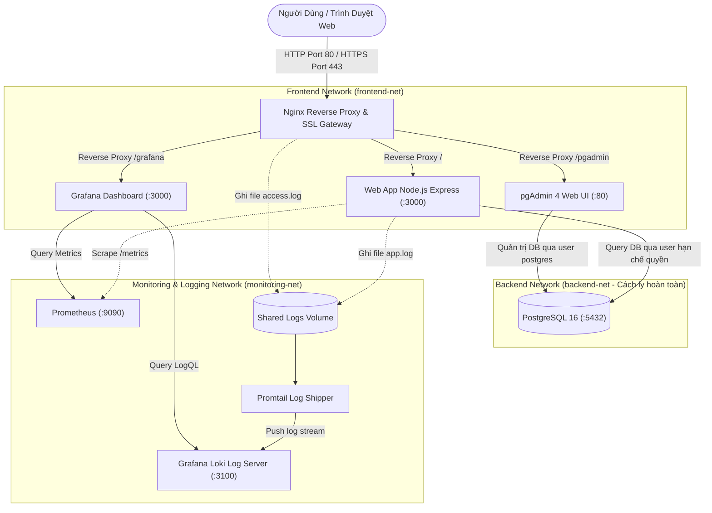

# HỆ THỐNG ĐẶT LỊCH HẸN TRỰC TUYẾN (MEDSCHEDULE)
## Đề tài 40: Triển Khai và Quản Trị Hệ Thống Phần Mềm

> **Học phần:** Triển khai và Quản trị Hệ thống Phần mềm  
> **Sinh viên thực hiện:** Nguyễn Minh Ngọc  
> **Mã sinh viên:** DTC245200817  
> **Repository:** [https://github.com/DTC245200817/appointment-system](https://github.com/DTC245200817/appointment-system)  

---

## MỤC LỤC
1. [Giới Thiệu Đề Tài](#1-giới-thiệu-đề-tài)
2. [Kiến Trúc Tổng Thể Hệ Thống](#2-kiến-trúc-tổng-thể-hệ-thống)
3. [Danh Sách Dịch Vụ, Cổng & Tài Khoản Mặc Định](#3-danh-sách-dịch-vụ-cổng--tài-khoản-mặc-định)
4. [Hướng Dẫn Triển Khai & Khởi Chạy Nhanh](#4-hướng-dẫn-triển-khai--khởi-chạy-nhanh)
5. [Chứng Minh Đáp Ứng Đầy Đủ 7 Tiêu Chí Đánh Giá](#5-chứng-minh-đáp-ứng-đầy-đủ-7-tiêu-chí-đánh-giá)
   - [Tiêu chí 1: Quản lý mã nguồn trên GitHub (1.5 điểm)](#tiêu-chí-1-quản-lý-mã-nguồn-trên-github-15-điểm)
   - [Tiêu chí 2: Triển khai ứng dụng + Database (1.5 điểm)](#tiêu-chí-2-triển-khai-ứng-dụng--database-15-điểm)
   - [Tiêu chí 3: Nginx Reverse Proxy (1.5 điểm)](#tiêu-chí-3-nginx-reverse-proxy-15-điểm)
   - [Tiêu chí 4: Hệ thống giám sát Prometheus + Grafana (1.5 điểm)](#tiêu-chí-4-hệ-thống-giám-sát-prometheus--grafana-15-điểm)
   - [Tiêu chí 5: Hệ thống log tập trung Loki + Promtail + LogQL (1.5 điểm)](#tiêu-chí-5-hệ-thống-log-tập-trung-loki--promtail--logql-15-điểm)
   - [Tiêu chí 6: Hardening bảo mật hệ thống (1.5 điểm)](#tiêu-chí-6-hardening-bảo-mật-hệ-thống-15-điểm)
   - [Tiêu chí 7: Tổng thể & Kịch bản Trình bày Demo (1.0 điểm)](#tiêu-chí-7-tổng-thể--kịch-bản-trình-bày-demo-10-điểm)
6. [Kịch Bản Demo Chi Tiết Từng Bước Cho Giảng Viên](#6-kịch-bản-demo-chi-tiết-từng-bước-cho-giảng-viên)

---

## 1. Giới Thiệu Đề Tài

Hệ thống **MedSchedule** là một giải pháp hoàn chỉnh cho phép khách hàng/bệnh nhân đặt lịch hẹn khám bệnh, kiểm tra khung giờ khả dụng theo thời gian thực, quản lý và tra cứu trạng thái lịch hẹn. Đồng thời hệ thống cung cấp cổng điều hành cho Quản trị viên (Admin Portal), được đóng gói hoàn toàn trong container thông qua Docker Compose, tích hợp giám sát hiệu năng với Prometheus & Grafana, thu thập log tập trung với Grafana Loki & Promtail và áp dụng đầy đủ các biện pháp Hardening bảo mật.

---

## 2. Kiến Trúc Tổng Thể Hệ Thống

Toàn bộ hệ thống được phân tách mạng rõ ràng (**Network Isolation**) gồm 3 phân vùng mạng Docker:



---

## 3. Danh Sách Dịch Vụ, Cổng & Tài Khoản Mặc Định

| Dịch Vụ | Container Name | Cổng Truy Cập (Port) | Đường Dẫn (URL) | Tài Khoản / Mật Khẩu Mặc Định |
|---|---|---|---|---|
| **Website Đặt Lịch** | `appointment_nginx` | `80` (HTTP) / `443` (HTTPS) | `http://localhost/` hoặc `https://localhost/` | Khách hàng truy cập tự do |
| **Admin Portal** | `appointment_nginx` | `80` / `443` | `http://localhost/admin` | Dành cho quản trị phòng khám |
| **pgAdmin 4** | `appointment_pgadmin` | `5050` (hoặc `/pgadmin`) | `http://localhost:5050` | `admin@appointment.com` / `AdminPgAdminP@ss_2026!` |
| **PostgreSQL 16** | `appointment_postgres` | `5432` (Nội bộ) | Kết nối qua pgAdmin | `postgres` / `StrongAdminP@ssw0rd_Postgres_2026!` |
| **Grafana Dashboard** | `appointment_grafana` | `3001` (hoặc `/grafana`) | `http://localhost:3001` | `admin` / `GrafanaAdminP@ss_2026!` |
| **Prometheus** | `appointment_prometheus`| `9090` | `http://localhost:9090` | Truy cập trực tiếp xem metrics thô |
| **Grafana Loki** | `appointment_loki` | `3100` | `http://localhost:3100/ready` | API nhận log stream |
| **Healthcheck App** | `appointment_app` | `3000` (Nội bộ) | `http://localhost/api/health` | Kiểm tra tình trạng kết nối DB |

---

## 4. Hướng Dẫn Triển Khai & Khởi Chạy Nhanh

### Yêu cầu tiên quyết:
- Máy tính đã cài đặt **Docker Desktop** (hỗ trợ WSL2 hoặc Hyper-V) và **Docker Compose**.
- Đã cài đặt **Git**.

### Các bước thực hiện:

#### Bước 1: Clone Repository về máy
```bash
git clone https://github.com/DTC245200817/appointment-system.git
cd appointment-system
```

#### Bước 2: Thiết lập file môi trường (.env)
File `.env` đã được chuẩn bị sẵn từ `.env.example`. Bạn có thể chỉnh sửa nếu muốn đổi mật khẩu:
```bash
# Trên Windows PowerShell / Command Prompt
copy .env.example .env

# Trên Linux / macOS
cp .env.example .env
```

#### Bước 3: Khởi chạy toàn bộ hệ thống
Khởi chạy tất cả 8 containers bằng **duy nhất 1 câu lệnh**:
```bash
docker compose up -d --build
```
*Hoặc trên Windows có thể nhấp đúp file `run.bat` và chọn số `1`.*

#### Bước 4: Kiểm tra trạng thái hệ thống
```bash
docker compose ps
```
Khi thấy tất cả các container đều hiển thị `Up` hoặc `Up (healthy)` là hệ thống đã sẵn sàng 100%!

---

## 5. Chứng Minh Đáp Ứng Đầy Đủ 7 Tiêu Chí Đánh Giá

### Tiêu chí 1: Quản lý mã nguồn trên GitHub (1.5 điểm)
- **Repository hoàn chỉnh:** Bao gồm toàn bộ source code backend, frontend tĩnh, cấu hình Nginx, cấu hình Prometheus, cấu hình Grafana (dashboard & datasources tự nạp), cấu hình Loki, Promtail và SQL khởi tạo database.
- **Tối thiểu 03 commit có ý nghĩa rõ ràng:**
  1. `feat(app,db): Khoi tao source code he thong dat lich hen va cau hinh PostgreSQL`
  2. `feat(proxy,security): Cau hinh Nginx Reverse Proxy, HTTPS, Security Headers va Hardening`
  3. `feat(monitoring,logging): Tich hop Prometheus, Grafana Dashboard, Loki, Promtail va README hoan chinh`
- **Tài liệu README:** Hướng dẫn chi tiết, chuẩn cấu trúc kỹ thuật, có bảng thông số, sơ đồ Mermaid và hướng dẫn test.

---

### Tiêu chí 2: Triển khai ứng dụng + Database (1.5 điểm)
- **Ứng dụng Website Đặt Lịch Hẹn (Đề 40):**
  - **Dịch vụ:** Hiển thị danh mục dịch vụ khám phong phú (Khám tổng quát, Tim mạch, Nha khoa, Xét nghiệm, Nhi khoa, Khám mắt), kèm thời lượng và giá tiền.
  - **Khung giờ:** Kiểm tra các khung giờ trống trong ngày (`/api/appointments/available-slots`). Không cho phép 2 khách hàng đặt trùng cùng 1 khung giờ.
  - **Khách hàng:** Nhập đầy đủ thông tin (Họ tên, SĐT, Email, Triệu chứng ghi chú), xác thực định dạng số điện thoại Việt Nam.
  - **Xác nhận:** Tạo mã đặt lịch độc nhất vô nhị dạng `APT-XXXXXX`, cấp thẻ hẹn và lưu vào database.
  - **Tra cứu & Hủy lịch:** Khách hàng có thể tra cứu lịch của mình bằng SĐT hoặc mã hẹn và chủ động hủy nếu bận việc.
  - **Cổng Quản Trị (Admin Portal):** Thống kê tổng quan số lịch theo trạng thái, duyệt lịch hẹn, đánh dấu hoàn thành, xem doanh thu ước tính.
- **Cơ sở dữ liệu PostgreSQL 16 & pgAdmin 4:**
  - Script `database/init.sql` tự động tạo schema, indexes, và nạp dữ liệu mẫu ban đầu.
  - pgAdmin 4 được cấu hình tự động kết nối qua `servers.json`, khi đăng nhập vào `http://localhost:5050` là thấy ngay Database `appointment_db` mà không cần cấu hình thủ công.

---

### Tiêu chí 3: Nginx Reverse Proxy (1.5 điểm)
- **Reverse Proxy chính xác:**
  - Cổng 80 và 443 tiếp nhận mọi request từ bên ngoài và chuyển tiếp:
    - `/` -> Container `app:3000`
    - `/pgadmin/` -> Container `pgadmin:80`
    - `/grafana/` -> Container `grafana:3000`
  - Giữ nguyên thông tin client qua các headers: `Host`, `X-Real-IP`, `X-Forwarded-For`, `X-Forwarded-Proto`.
- **Bảo mật HTTPS / SSL:**
  - Cấu hình SSL với chứng chỉ `server.crt` và khóa bí mật `server.key` tại `nginx/ssl/`.
  - Hỗ trợ giao thức an toàn `TLSv1.2` và `TLSv1.3`.
- **Security Headers & Rate Limiting:**
  - `X-Content-Type-Options "nosniff"`
  - `X-Frame-Options "SAMEORIGIN"`
  - `X-XSS-Protection "1; mode=block"`
  - `Strict-Transport-Security "max-age=31536000; includeSubDomains"`
  - `Referrer-Policy "strict-origin-when-cross-origin"`
  - Giới hạn tốc độ request `limit_req_zone` (20 req/s, burst 30) chống tấn công DoS / Brute-force.
  - `server_tokens off;` ẩn phiên bản Nginx.

---

### Tiêu chí 4: Hệ thống giám sát Prometheus + Grafana (1.5 điểm)
- **Prometheus Scraper:**
  - Định kỳ mỗi 5s thu thập metrics từ endpoint `http://app:3000/metrics`.
  - Thu thập metrics tài nguyên ứng dụng Node.js: CPU Usage, Heap Memory, RSS Memory, Event Loop Lag.
  - Thu thập metrics nghiệp vụ:
    - `http_requests_total`: Số lượng request HTTP phân theo method, route, status code.
    - `http_request_duration_seconds`: Histogram thời gian xử lý request (p95, p99 latency).
    - `appointment_bookings_total`: Tổng số lượt đặt lịch phân theo dịch vụ và trạng thái.
- **Grafana Dashboard:**
  - Tự động nạp cấu hình Datasource Prometheus (`provisioning/datasources/datasources.yml`).
  - Tự động nạp Dashboard chuyên nghiệp (`monitoring/grafana/dashboards/appointment-system.json`) hiển thị đầy đủ:
    1. Tổng số lịch hẹn đã đặt.
    2. Tần suất request (req/s).
    3. Độ trễ trung bình và p95/p99 latency.
    4. Phân bổ mã trạng thái HTTP (200, 400, 500...).
    5. Biểu đồ cột phân loại lịch hẹn theo từng chuyên khoa/dịch vụ.
    6. Mức sử dụng bộ nhớ Heap & RAM.
    7. Panel trực tiếp xem LogQL từ Loki.

---

### Tiêu chí 5: Hệ thống log tập trung Loki + Promtail + LogQL (1.5 điểm)
- **Loki & Promtail:**
  - Ứng dụng xuất log cấu trúc JSON có timestamp, level, action, booking_code ra cả console và file `/var/log/app/app.log`.
  - Nginx xuất log truy cập định dạng JSON ra `/var/log/nginx/access.log`.
  - Container `promtail` giám sát các file log này, bóc tách metadata (nhãn: `job="appointment-app"`, `job="nginx"`, `level`, `status`) và đẩy về Loki qua cổng `3100`.
- **Các câu truy vấn LogQL mẫu đã kiểm tra hoạt động tốt (dùng trên Grafana Explore):**
  1. **Xem toàn bộ log của Web App Đặt lịch:**
     ```logql
     {job="appointment-app"}
     ```
  2. **Lọc tất cả log có mức độ cảnh báo hoặc lỗi:**
     ```logql
     {job="appointment-app"} |= "error"
     ```
  3. **Lọc log các sự kiện khách hàng tạo lịch hẹn thành công:**
     ```logql
     {job="appointment-app"} |= "APPOINTMENT_CREATED"
     ```
  4. **Lọc log Nginx có mã phản hồi HTTP lỗi (>= 400):**
     ```logql
     {job="nginx"} | json | status >= 400
     ```
  5. **Tính toán tốc độ sinh log theo thời gian (Log Rate):**
     ```logql
     rate({job="appointment-app"}[1m])
     ```

---

### Tiêu chí 6: Hardening bảo mật hệ thống (1.5 điểm)
Hệ thống áp dụng **6 biện pháp bảo mật thực tế**:
1. **Non-root Container:**
   - Trong `Dockerfile`, tạo user và group không đặc quyền `appuser:appgroup` (UID 1001, GID 1001).
   - Chỉ thị `USER appuser` và khai báo `user: "1001:1001"` trong `docker-compose.yml` đảm bảo ứng dụng không bao giờ chạy dưới quyền root.
2. **Network Isolation (Phân vùng mạng Docker):**
   - Tách biệt 3 network ảo: `frontend-net`, `backend-net`, `monitoring-net`.
   - Cơ sở dữ liệu PostgreSQL nằm trong `backend-net`, hoàn toàn không kết nối với `frontend-net` và không mở cổng trực tiếp ra ngoài Internet, ngăn ngừa hoàn toàn nguy cơ quét cổng hoặc tấn công DB từ ngoài.
3. **Nguyên tắc Tối thiểu Quyền Hạn (Least Privilege) cho Database:**
   - Ứng dụng Web kết nối bằng tài khoản riêng `appointment_user` chỉ được cấp quyền `SELECT`, `INSERT`, `UPDATE`, `DELETE` trên bảng nghiệp vụ; **KHÔNG** có quyền `SUPERUSER`, `CREATEDB`, `CREATEROLE` hay `DROP DATABASE`.
4. **Quản lý Mật Khẩu Mạnh & Biến Môi Trường:**
   - Tuyệt đối không hardcode mật khẩu trong mã nguồn. Mọi mật khẩu đều lưu trong `.env`, có độ dài trên 16 ký tự bao gồm chữ hoa, chữ thường, chữ số và ký tự đặc biệt.
5. **Security Headers & Rate Limiting (Nginx):**
   - Thiết lập đầy đủ: HSTS, X-Frame-Options (chống Clickjacking), X-Content-Type-Options (chống MIME sniffing), CSP, X-XSS-Protection.
   - Giới hạn tần suất 20 req/s chống DoS/DDoS.
6. **Bảo mật Container Runtime (Security Options & Limits):**
   - Áp dụng `no-new-privileges:true` ngăn chặn leo thang đặc quyền trong container.
   - Giới hạn CPU và RAM (`deploy.resources.limits`) cho từng container để chống cạn kiệt tài nguyên máy chủ.

---

### Tiêu chí 7: Tổng thể & Kịch bản Trình bày Demo (1.0 điểm)
- Hệ thống chạy hoàn chỉnh và đồng bộ 100% bằng file `docker-compose.yml`.
- Cung cấp script tiện ích `run.bat` (Windows) và `run.sh` (Linux/macOS) giúp thao tác kiểm tra chỉ bằng một nút bấm.
- Có tài liệu kịch bản demo mẫu chi tiết để sinh viên tự tin thuyết trình và trả lời vấn đáp của giảng viên.

---

## 6. Kịch Bản Demo Chi Tiết Từng Bước Cho Giảng Viên

Khi lên báo cáo trước hội đồng, sinh viên thực hiện lần lượt các bước sau:

### Bước 1: Giới thiệu cấu trúc mã nguồn trên GitHub
- Mở link GitHub repository: [https://github.com/DTC245200817/appointment-system](https://github.com/DTC245200817/appointment-system)
- Chỉ rõ 3 commit có ý nghĩa trong tab Commits.
- Giới thiệu cấu trúc thư mục rõ ràng: `app/`, `database/`, `nginx/`, `monitoring/`, `logging/`, `docker-compose.yml`, `.env.example`.

### Bước 2: Khởi động hệ thống
- Mở Terminal/PowerShell và gõ:
  ```bash
  docker compose up -d
  docker compose ps
  ```
- Cho thầy cô xem danh sách cả 8 container đều đang `Up (healthy)`.

### Bước 3: Demo Website Đặt Lịch Hẹn & Database (Tiêu chí 2 & 3)
1. Mở trình duyệt truy cập `http://localhost`:
   - Bước 1: Chọn dịch vụ (ví dụ: *Khám Sức Khỏe Tổng Quát*).
   - Bước 2: Chọn ngày khám và chọn khung giờ (ví dụ: *09:00*).
   - Bước 3: Nhập thông tin: Nguyễn Văn An - 0912345678 - an@gmail.com.
   - Bước 4: Nhấn xác nhận đặt lịch -> Nhận mã đặt lịch hẹn dạng `APT-XXXXXX`.
2. Mở tab **Tra Cứu Lịch**: Nhập số điện thoại `0912345678` để thấy ngay lịch hẹn vừa tạo. Thử tính năng Hủy lịch.
3. Mở trang Quản trị `http://localhost/admin`:
   - Cho giảng viên thấy số liệu tổng quan nhảy tự động (Số lịch, Đang chờ, Đã duyệt, Doanh thu).
   - Bấm duyệt xác nhận lịch hẹn.
4. Mở pgAdmin tại `http://localhost:5050`:
   - Đăng nhập: `admin@appointment.com` / `AdminPgAdminP@ss_2026!`
   - Vào server `PostgreSQL Appointment DB` -> `Databases` -> `appointment_db` -> `Tables` -> `appointments` để chứng minh dữ liệu lưu thực tế vào PostgreSQL.

### Bước 4: Demo Nginx Reverse Proxy & HTTPS (Tiêu chí 3)
- Mở đường dẫn `https://localhost` (chấp nhận self-signed cert).
- Nhấn F12 (Inspect Element) -> Tab **Network** -> Click vào 1 request bất kỳ:
  - Chỉ cho giảng viên thấy các **Response Headers**:
    - `Server: nginx` (đã ẩn số phiên bản)
    - `Strict-Transport-Security: max-age=31536000; includeSubDomains`
    - `X-Frame-Options: SAMEORIGIN`
    - `X-Content-Type-Options: nosniff`

### Bước 5: Demo Prometheus & Grafana Dashboard (Tiêu chí 4)
- Truy cập Grafana: `http://localhost:3001` (Tài khoản: `admin` / `GrafanaAdminP@ss_2026!`).
- Mở Dashboard: **Giám Sát Hệ Thống Đặt Lịch Hẹn - MedSchedule**.
- Chỉ cho giảng viên xem các biểu đồ:
  - Tần suất request `rate(http_requests_total[1m])`
  - Biểu đồ thời gian phản hồi (Latency)
  - Biểu đồ phân bổ lịch hẹn theo dịch vụ (Appointment Bookings by Service)
  - Mức tiêu thụ bộ nhớ Heap của Node.js.

### Bước 6: Demo Log Tập Trung Loki & Truy Vấn LogQL (Tiêu chí 5)
- Trong Grafana, vào mục **Explore** (biểu tượng la bàn) -> Chọn Datasource là **Loki**.
- Thực hiện chạy 2-3 câu query LogQL:
  ```logql
  {job="appointment-app"}
  ```
  *(Hiển thị toàn bộ log luồng xử lý của backend)*
  ```logql
  {job="appointment-app"} |= "APPOINTMENT_CREATED"
  ```
  *(Hiển thị đúng log khi khách hàng đặt lịch thành công kèm mã APT)*
  ```logql
  {job="nginx"} | json | status >= 200
  ```
  *(Hiển thị log truy cập từ Nginx)*

### Bước 7: Trình bày các biện pháp Hardening (Tiêu chí 6)
- Mở file `app/Dockerfile` chỉ cho giảng viên thấy dòng `USER appuser` (Non-root).
- Mở file `database/init.sql` chỉ dòng `CREATE ROLE appointment_user ... NOSUPERUSER` và phân quyền giới hạn (Least Privilege).
- Mở `docker-compose.yml` chỉ phần cấu hình `networks` (frontend-net, backend-net, monitoring-net) chứng minh PostgreSQL hoàn toàn không mở cổng ra ngoài.
- Chỉ phần `security_opt: [ "no-new-privileges:true" ]` và giới hạn `resources.limits`.

---
*Chúc bạn có buổi bảo vệ đề tài thành công xuất sắc và đạt điểm tối đa 10/10!*